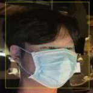
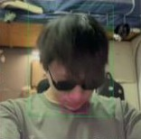
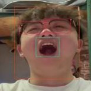
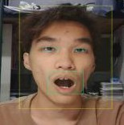
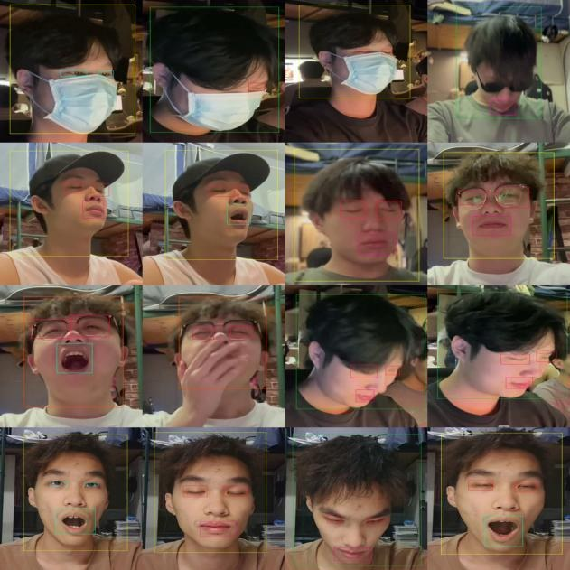
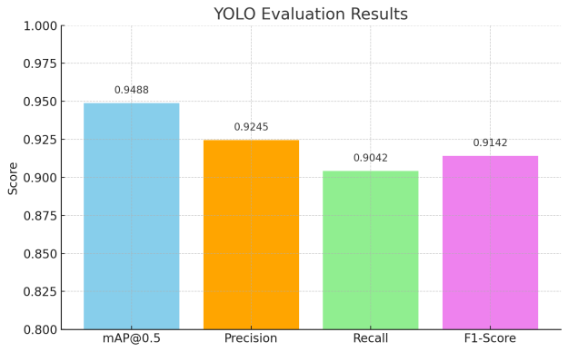
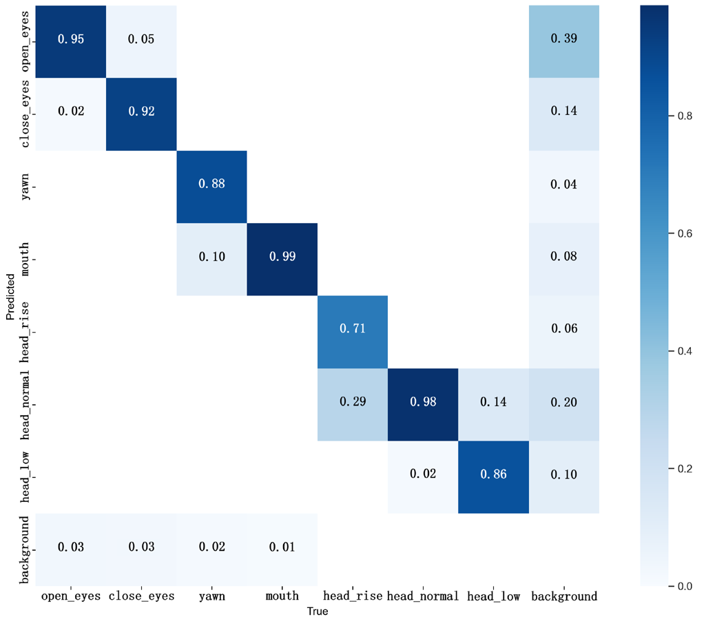

# Driver Fatigue Detection Dataset

驾驶员疲劳检测数据集：9,751 张模拟车内视角图像，7 类 YOLO 标注（眼部、嘴部、头部姿态），用于 YOLO11 多特征疲劳检测研究（IEEE ICEICT 2025）。

A public set of **9,751** JPEG images for vision-based driver fatigue detection. Each image is a simulated in-vehicle view with YOLO bounding boxes for **seven** facial and head-pose classes. The set was built for a comparative study of multi-feature fusion on top of an Ultralytics YOLO11 detector, published at IEEE ICEICT 2025.

The images and labels are distributed as `driver-fatigue-dataset.zip` (about 1 GB) on Baidu Netdisk. This repository documents the release: classes, splits, directory layout, label format, and citation.

| | |
| --- | --- |
| Images | 9,751 `.jpg` |
| Resolution | 640 × 640, as reported for the dataset |
| Labels | YOLO `.txt` (one object per line) |
| Classes | 7: eyes, mouth, head posture |
| Split | train 7,800 / val 976 / test 975 (described as 8:1:1) |
| Annotation | CVAT |
| Paper | [ICEICT 2025](https://doi.org/10.1109/iceict66683.2025.11160205), pp. 439–444 |
| Archive | `driver-fatigue-dataset.zip`, about 1 GB |
| License | [CC BY 4.0](LICENSE) |

## Sample images

Figure 1 of the paper is a 4×4 sheet of example frames. The crops below come from that sheet as printed. The zip holds the original 640 × 640 frames. Boxes in the crops are the overlays already drawn in the figure.

<table>
  <tr>
    <td align="center" width="33%"><br>Face mask; eyes open</td>
    <td align="center" width="33%"><br>Sunglasses; head lowered</td>
    <td align="center" width="33%"><br>Eyeglasses; eyes open, mouth closed</td>
  </tr>
  <tr>
    <td align="center"><br>Eyes closed; mouth closed</td>
    <td align="center"><br>Eyes closed; mouth open</td>
    <td align="center"><br>Mouth wide open, eyes closed; head tilted back</td>
  </tr>
  <tr>
    <td align="center"><br>Hand covering the mouth; eyes closed</td>
    <td align="center"><br>Eyes open; mouth open</td>
    <td align="center"><br>Head lowered</td>
  </tr>
</table>

The full sheet, as embedded in the paper:

<p align="center"></p>

Captions name what is visible in each crop: a mask, sunglasses, eyeglasses, a hand over the mouth, eyes open or closed, mouth open or closed, head lowered or tilted back. The figure caption does not give each cell a class id.

Source: Yi Li, Changwen Fan, Le Yang, Yingqi Wang, Pao-Min Tu, and Jung-Kuei Yang, Figure 1 in “A Comparative Study on Fatigue Detection Models With Temporal Feature Fusion,” *2025 IEEE 8th International Conference on Electronic Information and Communication Technology (ICEICT)*, pp. 439–444. DOI: [10.1109/iceict66683.2025.11160205](https://doi.org/10.1109/iceict66683.2025.11160205). Cite the paper under the publisher’s terms if you reuse these figures.

## Paper

Yi Li, Changwen Fan, Le Yang, Yingqi Wang, Pao-Min Tu, and Jung-Kuei Yang (corresponding author).  
GuangDong-TaiWan College of Industrial Science & Technology, Dongguan University of Technology, GuangDong, China.

> **A Comparative Study on Fatigue Detection Models With Temporal Feature Fusion.**  
> 2025 IEEE 8th International Conference on Electronic Information and Communication Technology (ICEICT), Weihai, China, 26–28 July 2025, pp. 439–444.  
> DOI: [10.1109/iceict66683.2025.11160205](https://doi.org/10.1109/iceict66683.2025.11160205) · IEEE Xplore: [11160205](https://ieeexplore.ieee.org/document/11160205/)

The study trains YOLO11 to detect eye state, mouth state, and head posture, then compares three ways of turning those detections into a fatigue decision:

1. **Rule-based threshold fusion.** The paper marks fatigue when any two of the three feature groups exceed their thresholds (Table I). Eye indicators are PERCLOS above 30% and a blink rate under 15 per minute. Mouth indicators are a yawning frequency above 3 per minute, or a single yawn longer than 0.8 seconds. A downward head pose counts as fatigue when the deviation exceeds 15° and that pose occurs more than twice per minute.
2. **Weighted sliding-window scoring.** At 30 FPS, statistics are taken over a window of 30–60 frames (about 1–2 seconds). The paper uses the score S = 0.5 × PERCLOS + 0.3 × YFR + 0.2 × HFR, and raises an alert when S exceeds 0.6.
3. **YOLO11-LSTM temporal fusion.** Each frame is a 10-dimensional vector: the seven detection confidences, plus three binary visibility flags (eye occlusion, mouth occlusion, and combined occlusion). A single LSTM layer with hidden size 64 reads a 60-frame window. A fully connected layer and a sigmoid produce a fatigue probability; the paper triggers an alert above 0.6.

The paper trains and tests Ultralytics YOLO11 with PyTorch 2.0.1 and OpenCV, on Windows 11 with an Intel Core i9-12900K, an NVIDIA RTX 3090 (24 GB), and 64 GB DDR5 RAM. Images were resized to 640 × 640. The initial learning rate is 0.001 in both places it is printed. The optimizer, batch size, and epoch count disagree; both statements are in [Results](#results-reported-in-the-paper).

## Classes

Label tokens follow Table I of the paper. Counts are from Table II and record how many images include that behavior. An image can carry more than one class, so the category rows can overlap. The last row is the number of images in each split.

The dataset-construction paragraph lists the mouth category as “mouth open.” Table II prints **Mouth Closed**. The label token in this release is `mouth`. Table II also calls `head_low` **Head Down**, `head_normal` **Normal Head Posture**, and `head_rise` **Head Up**. Row order below follows Table I. Table II prints Head Up, then Head Down, then Normal Head Posture.

| Class | Table II name | Group | Train | Val | Test | Total |
| --- | --- | --- | ---: | ---: | ---: | ---: |
| `open_eyes` | Open Eyes | Eye | 5,004 | 639 | 614 | 6,257 |
| `close_eyes` | Closed Eyes | Eye | 2,023 | 235 | 237 | 2,495 |
| `yawn` | Yawning | Mouth | 497 | 58 | 76 | 631 |
| `mouth` | Mouth Closed | Mouth | 6,601 | 819 | 812 | 8,232 |
| `head_low` | Head Down | Head | 858 | 93 | 93 | 1,044 |
| `head_normal` | Normal Head Posture | Head | 6,617 | 841 | 827 | 8,285 |
| `head_rise` | Head Up | Head | 319 | 41 | 55 | 415 |
| **Images in the split** | | | **7,800** | **976** | **975** | **9,751** |

Head-pose labels were assigned by visual inspection. YOLO11 detects all seven classes from image appearance.

## Driving conditions

The paper includes the following conditions so the detector sees common in-cabin interference. Figures are image counts for each condition.

| Condition | Images |
| --- | ---: |
| Low light | 1,133 |
| Strong light | 2,435 |
| Passengers in the cabin | 3,557 |
| Face mask | 663 |
| Sunglasses | 661 |
| Other occlusions (hair, hands, or clothing) | 334 |

The paper also names cabin distractions and varied camera angles. Table III compares this coverage with NTHU-DDD and DR(eye)VE. Wording below is the wording printed in that table.

| Feature | NTHU-DDD | DR(eye)VE | This dataset |
| --- | --- | --- | --- |
| Fatigue behavior | Available (open eyes, closed eyes, yawn, nodding) | N/A (only continuous attention tracking) | 7 fine-grained behaviors |
| Low-light conditions | Yes | Yes | Yes (1,133 images) |
| Strong light exposure | No | Yes | Yes (2,435 images) |
| Passengers in frame | No | No (single-driver scenes only) | Yes (3,557 images) |
| Wearing mask | No | No | Yes (663 images) |
| Wearing sunglasses | Yes | No | Yes (661 images) |
| Other occlusions | Not clearly stated | No | Yes (334 images) |
| Number of behavior categories | 4 | N/A | Yes (7 categories) |

## Quick start

1. Download `driver-fatigue-dataset.zip` (about 1 GB) from Baidu Netdisk: https://pan.baidu.com/s/1_cXVKDS1Atz_vM73icm6Jw?pwd=6p17 (access code `6p17`).
2. Unzip it and keep `train/`, `val/`, and `test/`. Each split has `images/` and `labels/`.
3. Add a YOLO data file next to those three folders. The sketch below lists class names in the same order as the [Classes](#classes) table (Table I). After unzipping, open a few label files and keep `names` in the index order those files already use. The integers in the `.txt` files are the source of truth.

```yaml
# data.yaml — sketch. Confirm name order against the label files.
path: .
train: train/images
val: val/images
test: test/images

names:
  0: open_eyes
  1: close_eyes
  2: yawn
  3: mouth
  4: head_low
  5: head_normal
  6: head_rise
```

Point Ultralytics YOLO11 at this file. The paper resizes inputs to 640 × 640. The paper leaves the YOLO11 size variant (`n`, `s`, `m`, `l`, or `x`) unspecified. The printed optimizer, batch size, and epoch count disagree across the methods paragraph and Table IV, so the quick start stops at this data file and the 640 input size.

## Files and label format

After unzipping, keep this layout:

```text
driver-fatigue-dataset/
├── train/
│   ├── images/
│   └── labels/
├── val/
│   ├── images/
│   └── labels/
└── test/
    ├── images/
    └── labels/
```

Each `.jpg` has a `.txt` file with the same stem in the matching `labels/` folder. The text files use YOLO detection format, one object per line:

```text
<class_id> <x_center> <y_center> <width> <height>
```

`class_id` is the integer index of one of the seven classes. The four box values are the center and the size of the box. In the YOLO convention used for these labels, they are normalized by image width and height and fall between 0 and 1.

## Download

The archive is on Baidu Netdisk:

- **File:** `driver-fatigue-dataset.zip` (about 1 GB)
- **Link:** https://pan.baidu.com/s/1_cXVKDS1Atz_vM73icm6Jw?pwd=6p17
- **Access code:** `6p17`

Unzip it and leave the `train`, `val`, and `test` folders intact.

## Results reported in the paper

The numbers in this section are the ones printed in the paper.

**YOLO11 detection.** On the validation set the paper reports mAP@0.5 of **0.9488**. For classification performance it reports precision **0.9245**, recall **0.9042**, and F1 **0.9142**. The confusion matrices show clear separation of open and closed eyes, some confusion between the normal head pose and the other head poses, and overlap between yawning and mouth closed.

<p align="center"></p>

*Figure 3 of the paper. Bars are mAP@0.5 0.9488, precision 0.9245, recall 0.9042, and F1 0.9142. The paper caption calls this the detection performance of YOLO11 on fatigue-related categories after training.*

<p align="center"></p>

*Figure 2 of the paper: normalized confusion matrices of YOLO11 after training.*

Both figures are reproduced from Li et al., ICEICT 2025, DOI [10.1109/iceict66683.2025.11160205](https://doi.org/10.1109/iceict66683.2025.11160205).

**Training setup printed in the paper.** The paragraph that introduces Table IV says the model was trained for 100 epochs using SGD, with initial learning rate 0.001 and batch size 32. Table IV prints batch size 16, 200 epochs, and Adam. The learning rate matches (1×10⁻³). Both statements are reproduced side by side.

| Parameter | Table IV value | Table IV note |
| --- | --- | --- |
| Batch size | 16 | Dynamically adjusted based on GPU memory |
| Initial learning rate | 1×10⁻³ | Controls the update step size for model parameters |
| Epochs | 200 | Early stopping applied (validation mAP not improved over 5 consecutive epochs) |
| Optimizer | Adam | Weight decay set to 5×10⁻⁴ |

**Fusion on a 3-minute video** (Table V). The clip runs at 30 FPS (about 5,400 frames) and was recorded by one subject with the camera angle aligned to the still-image set. The paper splits it into normal driving (0–60 s), mild fatigue (60–90 s), and severe fatigue (90–180 s), and computes the scores below from detections sampled at one frame per second. The latency column is printed as “Latency (fps) (Approx. Delay)”; both numbers from each cell are shown.

| Strategy | Accuracy | Precision | Recall | F1 | Latency (fps) | Approx. delay |
| --- | ---: | ---: | ---: | ---: | ---: | ---: |
| Threshold fusion | 0.88 | 1.00 | 0.81 | 0.90 | 573.0 | ≈ 19.09 s |
| Sliding-window scoring | 0.52 | 1.00 | 0.23 | 0.37 | 491.0 | ≈ 16.36 s |
| YOLO11-LSTM | 0.94 | 0.96 | 0.94 | 0.95 | 7.0 | ≈ 0.23 s |

The abstract states the same YOLO11-LSTM headline: 94% accuracy, 96% precision, and a delay of 0.23 seconds. In the Table V discussion, precision for the first two strategies is also written as 100%, recall as 81% and 23%, and accuracy as 88% and 52%.

## Citation

Please cite the paper if you use this dataset.

Yi Li, Changwen Fan, Le Yang, Yingqi Wang, Pao-Min Tu, and Jung-Kuei Yang, “A Comparative Study on Fatigue Detection Models With Temporal Feature Fusion,” in *2025 IEEE 8th International Conference on Electronic Information and Communication Technology (ICEICT)*, Weihai, China, 2025, pp. 439–444, doi: [10.1109/iceict66683.2025.11160205](https://doi.org/10.1109/iceict66683.2025.11160205).

```bibtex
@inproceedings{li2025fatigue,
  author    = {Yi Li and Changwen Fan and Le Yang and Yingqi Wang and Pao-Min Tu and Jung-Kuei Yang},
  title     = {A Comparative Study on Fatigue Detection Models With Temporal Feature Fusion},
  booktitle = {2025 IEEE 8th International Conference on Electronic Information and Communication Technology (ICEICT)},
  address   = {Weihai, China},
  pages     = {439--444},
  year      = {2025},
  doi       = {10.1109/iceict66683.2025.11160205},
  url       = {https://doi.org/10.1109/iceict66683.2025.11160205}
}
```

The paper’s own reference for this archive points at this repository: Y. Li, C. Fan, L. Yang, Y. Wang, and J.-K. Yang, “Driver fatigue detection dataset,” 2025. [Online]. Available: https://github.com/SH0TGUN666/driver-fatigue-dataset

## License

This repository is released under the [Creative Commons Attribution 4.0 International License (CC BY 4.0)](LICENSE). You may share and adapt the material with appropriate credit. Cite the IEEE paper under the publisher’s terms.

## Acknowledgment

The paper states that the study was supported by the Undergraduate Innovation and Entrepreneurship Training Program of Dongguan University of Technology.
